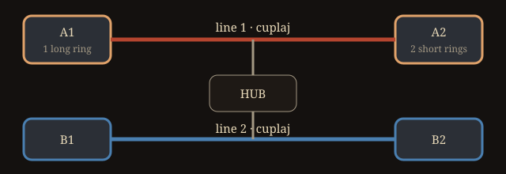

# CUPLAJ

**English** · [Română](README.ro.md) · [Français](README.fr.md) · [Italiano](README.it.md) · [Español](README.es.md) · [Português](README.pt.md) · [Deutsch](README.de.md) · [Magyar](README.hu.md)

> **Party-line telephony for immersive theatre**

_Version: 1.1.0 · Last update: 2026-11-24_

CUPLAJ turns a fleet of ordinary Android phones into a private telephone exchange for immersive theatre. Organisers and actors talk to spectators (and to each other) over the venue's local Wi‑Fi — no cloud, no accounts, no ads. Its signature feature is the *cuplaj*: the shared **party line** of fixed telephones from the 1980s to about 2006, where two subscribers shared one line, rang with different cadences, and could overhear each other.

## Features

- **Three telephone eras** — 1985 rotary dial (audible pulses), 1995 keypad (DTMF tones), 2003 mobile (SMS, 160 characters). The control can switch the era live.
- **Party line (cuplaj)** — two phones share one line; a call to one rings both with the called subscriber's cadence; the neighbour who picks up first takes the call; lifting the handset during a neighbour's call lets you listen in, and even break in.
- **No infrastructure** — one phone (the control) is the hub. Others join via Wi‑Fi or the hub's hotspot; hubs are found automatically; optional room code and PIN.
- **Voice** — real calls (8 kHz), push‑to‑talk public address from the control, backstage channel for the crew.
- **Cues** — full‑screen text, vibration, ring, flash, loudspeaker, era change, new contact, spoken voice (local text‑to‑speech), sound effects, black screen, phantom call.
- **Script** — a cue list with GO and PLAY (timed), reorder, import/export as JSON.
- **Control tools** — numbers, groups, couple/uncouple, automatic pairs, silent monitor, mute, forget, battery levels, event log, state that survives restarts, rate limiting.
- **8 languages and accessibility** — English, Romanian, French, Italian, Spanish, Portuguese, German, Hungarian; adjustable text size; answer from the lock screen; keeps running in the background.
- **Internet and mobile data (1.1)** — connect with `host` or `host:port`; optional AES‑128‑GCM network key; automatic G.711 compression off the local network; keepalive.
- **Direct P2P calls (1.1)** — audio goes phone‑to‑phone over UDP with hole punching, falling back to the hub relay; the control can set it off, local‑only (default) or anywhere.
- **VoIP / SIP gateway (1.1)** — the control phone registers with a SIP provider or PBX; the crew dials `0`+number to call out, incoming SIP calls ring an internal number.
- **Mobile network (1.1)** — SMS gateway through the control phone's SIM (send and receive), a *real call* cue that opens the dialler, and a Wi‑Fi / mobile indicator.

## Quick start

1. Get the APK from the *Actions* tab (artifact `CUPLAJ-apk`) or the *Releases* page and install it on every phone.
2. On the control phone, start the hotspot (or put all phones on the same Wi‑Fi).
3. On the control phone choose **Control** → *Start the hub*. Note the PIN for actors and, optionally, a room code.
4. On the other phones choose **Spectator** or **Actor**, pick the hub from the list (or type its address), and connect.
5. Every phone gets a number (control 100, actors 201…, spectators 6 digits). Lift the handset and call.

## The three eras

- **1985 · rotary** — a round dial you really turn; the pulses are audible; two long rings.
- **1995 · keypad** — DTMF tones, notebook of numbers, pager messages.
- **2003 · mobile** — names in the contact list, caller ID, SMS limited to 160 characters.

## How the party line works

1. Two phones are *coupled* by the control (or automatically in pairs). They share line N, slots 1 and 2.
2. A call to subscriber 1 rings both phones; subscriber 1 hears the cadence of their own number (one long ring), subscriber 2 hears the other (two short rings).
3. Whoever answers takes the call; the other phone stops ringing.
4. While the line is in use, the neighbour who lifts the handset hears the conversation and a faint click is heard by the parties.
5. A listener may *break in* and speak; a call to a coupled phone whose line is busy gets the busy tone.
6. The control can monitor any line silently (no click).

## Documentation

- [User guide](docs/GUIDE.md)
- [Protocol](docs/PROTOCOL.md) *(English)*
- [Adversarial audit](docs/AUDIT.md) *(English)*
- [Changelog](CHANGELOG.md) *(English)*
- [Presentation site](https://chiuta.github.io/CUPLAJ/)

## Honest status

The hub logic (calls, party line, permissions, limits, persistence) is covered by ~55 automated checks that run on a JVM. The Android user interface and audio path have been type‑checked against the Android 14 SDK but **not yet tested on physical devices**; the APK is built by GitHub Actions. Test with a handful of phones before a show. Traffic on the local network is not encrypted (the PIN and room code keep honest strangers out, they are not cryptography). Version 1.1 networking (encryption, P2P, SIP, SMS) is covered by hub tests against a simulated SIP server, but has **not** been tried on real operators, NATs or SIM cards.

## Build

Requires JDK 17. `./gradlew assembleRelease` produces `app/build/outputs/apk/release/app-release.apk` (signed with the debug key, installable directly). Unit tests: `./gradlew test`. The workflow in `.github/workflows` does both with Node ≥ 24 tooling on Ubuntu 26.04.

## Privacy

No analytics, no servers, no accounts. Audio and messages travel only inside your local network, between the phones and the hub. The hub keeps numbers, groups and couplings on the control phone so a restart does not lose them.

## Support the project

CUPLAJ is free and trade‑free. If it helps your show, you can buy the author a coffee: <https://buymeacoffee.com/echo.of.the.strings>.

## Licence

MIT © Alexandru‑Ionuț Chiuță (Alexio).
